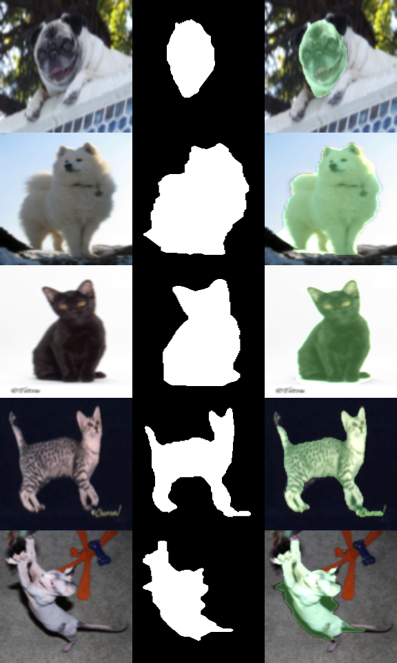
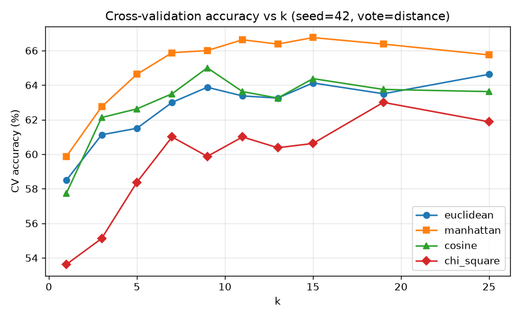
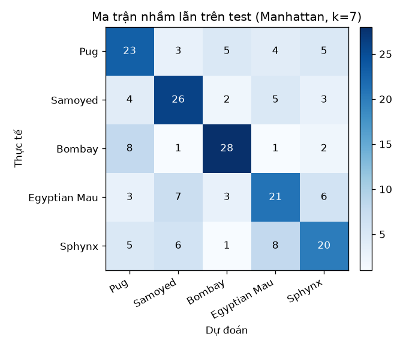
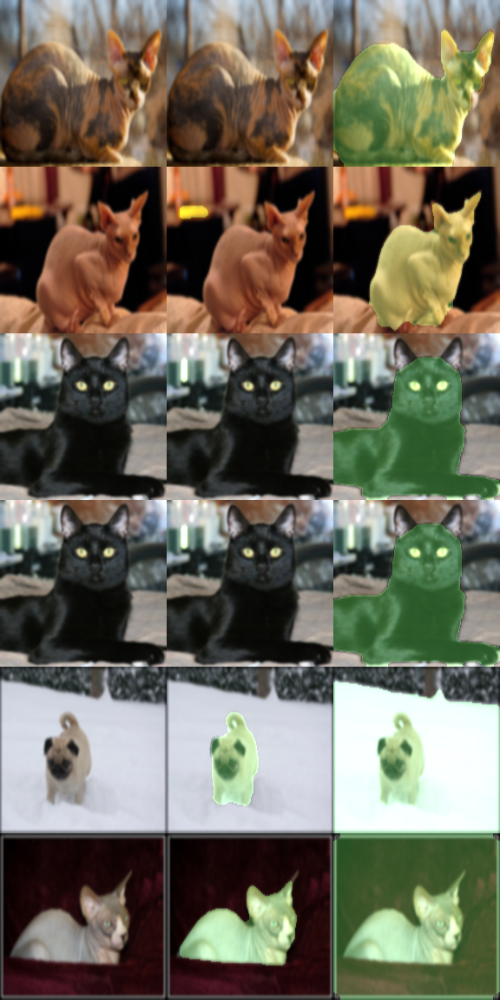

# Pet-Classifier-kNN: Nhận dạng giống thú cưng bằng k-NN trên đặc trưng ảnh



Nhận dạng 5 giống chó/mèo trong bộ Oxford-IIIT Pet bằng thuật toán k láng giềng gần nhất (k-NN), dựa trên đặc trưng **màu** và **hình dạng** trích từ ảnh.

Đây là bài tập môn xử lý ảnh (đề 34: *Nhận dạng đối tượng bằng k-NN dựa trên đặc trưng ảnh*). Toàn bộ phần k-NN và đánh giá được tự cài bằng NumPy, không dùng scikit-learn. OpenCV chỉ dùng cho các thao tác xử lý ảnh (đổi không gian màu, GrabCut, contour, moments).

Project vẫn đang được cải thiện dần, mục tiêu là dễ hiểu từ đầu đến cuối chứ không phải độ chính xác cao nhất.

## Cách hoạt động

Mỗi ảnh đi qua pipeline sau:

    ảnh gốc -> resize (cạnh dài 192px) -> Gaussian blur 5×5 ↩
            -> GrabCut (khởi tạo bằng mask viền/tâm, 5 vòng) + morphology + giữ vùng lớn nhất -> mask đối tượng ↩
            -> đặc trưng màu (HSV) + đặc trưng hình học (contour) -> vector 27 chiều ↩
            -> chuẩn hóa z-score -> k-NN (Euclidean / Manhattan) -> nhãn giống

## Tổng quan

Đề bài yêu cầu bốn phần, và project đáp ứng như sau:

| Yêu cầu | Cách làm |
|---|---|
| Tiền xử lý và phân đoạn đối tượng | Resize, làm mờ, GrabCut, đóng/mở hình thái học, giữ contour lớn nhất; chất lượng mask được chấm bằng IoU so với trimap của Oxford |
| Trích đặc trưng màu và hình dạng | Thống kê và histogram HSV trên vùng đối tượng; tỷ lệ khung, độ đặc, độ tròn, độ thon (Hu moments có trích nhưng không dùng mặc định) |
| Cài đặt k-NN, khảo sát ảnh hưởng của $k$ hoặc khoảng cách | k-NN tự viết; khảo sát $k$ từ 1 đến 25 với cả Euclidean và Manhattan bằng cross-validation |
| Đánh giá bằng độ chính xác và ma trận nhầm lẫn | Accuracy, confusion matrix 5×5, precision / recall / F1 theo lớp, đều tự cài |

Ngoài ra có một desktop app (CustomTkinter) để nhận dạng từng ảnh và xem kết quả đánh giá trực quan.

## Kết quả

Quy trình đánh giá:

1. Chia 800 ảnh train / 200 ảnh test, phân tầng theo lớp (mỗi giống 40 ảnh test).
2. **Chỉ trên tập train**, chạy cross-validation 5 fold cho mọi cặp khoảng cách × $k$ ($k$ = 1, 3, 5, 7, 9, 11, 13, 15, 19, 25) và chọn cặp có accuracy CV cao nhất.
3. Dùng cặp đã chọn, đánh giá **đúng một lần** trên tập test.
4. Lặp lại toàn bộ với 10 cách chia khác nhau (seed 0–9) để biết kết quả dao động bao nhiêu.

Tập test không được dùng để chọn $k$, nên con số báo cáo là ước lượng không thiên lệch.

| | Accuracy trên test |
|---|---:|
| Trung bình 10 seed | **61.1% ± 2.8%** (thấp nhất 57.0%, cao nhất 65.0%) |
| `seed=42` (CV chọn Manhattan, $k=9$) | 64.0% |

Đoán ngẫu nhiên với 5 lớp chỉ đạt 20%.

| Accuracy CV theo k (`seed=42`) | Ma trận nhầm lẫn trên test (`seed=42`) |
|---|---|
|  |  |

Nhận xét:

- **Manhattan tốt hơn Euclidean ở gần như mọi giá trị $k$**, và được CV chọn ở cả 10 seed. Khoảng cách L1 ít bị chi phối bởi một vài chiều lệch lớn, phù hợp khi vector trộn nhiều loại đặc trưng.
- **$k$ nhỏ kém rõ rệt**: $k=1$ chỉ đạt khoảng 50–56%, vì một láng giềng duy nhất quá nhạy với ảnh bị phân đoạn lỗi. Accuracy tăng tới khoảng $k=9$ rồi gần như phẳng tới $k=25$.
- **Bombay** và **Samoyed** nhận dạng tốt nhất (30/40 mỗi giống) nhờ màu lông đặc trưng: đen tuyền và trắng.
- **Egyptian Mau** hay bị nhầm thành Pug (9 ảnh); **Sphynx** hay bị nhầm thành Samoyed (8) và Egyptian Mau (6). Nét phân biệt của Mau là đốm, tức kết cấu, không nằm trong đặc trưng màu hay hình dạng.
- **Pug** có precision thấp nhất (50%): nhiều ảnh của giống khác bị đoán là Pug. Mask của Pug thường không đầy đủ (chỉ lấy được mặt) nên đặc trưng Pug trải rộng.

### Đóng góp của từng nhóm đặc trưng

Cùng quy trình trên, 10 seed:

| Đặc trưng | Số chiều | Accuracy |
|---|---:|---:|
| Màu + hình học + Hu | 34 | 60.6% ± 2.5 |
| **Màu + hình học (mặc định)** | 27 | **61.1% ± 2.8** |
| Chỉ màu | 22 | 58.6% ± 3.3 |
| Chỉ hình học | 5 | 31.1% ± 3.5 |
| Chỉ Hu moments | 7 | 29.3% ± 0.8 |

- **Màu mang phần lớn thông tin**, 5 đặc trưng hình học bổ sung thêm khoảng 2.5 điểm.
- **Hu moments gần mức đoán bừa** khi dùng một mình và không giúp khi gộp. Project bỏ chúng vì vector gọn hơn mà không mất gì; mức chênh 0.5 điểm nằm trong độ dao động nên không phải lý do.

### Chất lượng phân đoạn

Trimap của bộ Oxford (mask do người gán nhãn) được dùng **chỉ để chấm điểm** mask GrabCut, không bao giờ dùng để trích đặc trưng. Thước đo là IoU: diện tích phần giao chia diện tích phần hợp giữa mask và trimap.

| Cách khởi tạo GrabCut | IoU trung bình | Ảnh phân đoạn sai nặng (IoU < 0.5) | Accuracy nhận dạng (10 seed) |
|---|---:|---:|---:|
| Hình chữ nhật cách mép 8%, 1 vòng (cũ) | 0.655 | 27.4% | 59.3% ± 3.6 |
| **Mask viền/tâm, 5 vòng (hiện tại)** | **0.716** | **22.1%** | **61.1% ± 2.8** |

Cách cũ coi toàn bộ 8% sát mép là nền chắc chắn, nên mọi phần con vật chạm mép ảnh (rất phổ biến với ảnh thú cưng) đều bị cắt mất; khi con vật chiếm gần hết khung hình, mask thường rỗng. Cách mới chỉ coi 1% ngoài cùng là nền chắc chắn, dải 5% tiếp theo là "có thể là nền", và một elip nhỏ ở tâm ảnh là "chắc chắn là con vật".

Trên 990 ảnh có trimap hợp lệ: 342 ảnh có IoU tăng hơn 0.05, 149 ảnh giảm hơn 0.05, 499 ảnh gần như không đổi. Accuracy cross-validation trên tập train tăng ở cả 10/10 seed (trung bình từ 59.1% lên 62.9%).



Mỗi hàng: ảnh, mask cũ, mask mới. Bốn hàng đầu là các ảnh cải thiện nhiều nhất, hai hàng cuối là các ảnh tệ đi nhiều nhất: với nền đồng nhất (tuyết, nền tối), mask mới tràn ra gần hết ảnh.

## Các giống được chọn

| Thư mục | Giống | Đặc điểm nổi bật |
|---|---|---|
| `pug` | Chó Pug | Lông vàng kem, mặt ngắn, thân tròn |
| `samoyed` | Chó Samoyed | Lông trắng muốt, xù |
| `Bombay` | Mèo Bombay | Lông đen tuyền |
| `Egyptian_Mau` | Mèo Ai Cập | Lông xám đốm vằn, tai nhọn |
| `Sphynx` | Mèo không lông | Da hồng/xám, thân mảnh |

Năm giống này được chọn vì khác nhau rõ về màu và dáng, phù hợp với đặc trưng màu và hình dạng mà đề yêu cầu.

## Đặc trưng ảnh

Mỗi ảnh được trích 34 chiều, chỉ tính trên các pixel thuộc mask đối tượng. Mặc định dùng 27 chiều đầu (màu + hình học).

**Màu (22 chiều), không gian HSV**

- trung bình H, S, V (3)
- độ lệch chuẩn H, S, V (3)
- histogram H 8 bin, S 4 bin, V 4 bin, đã chuẩn hóa về tổng bằng 1 (16)

**Hình học (5 chiều), từ contour lớn nhất**

- aspect ratio: rộng / cao của bounding box
- extent: diện tích / diện tích bounding box
- solidity: diện tích / diện tích bao lồi
- circularity: $4\pi A / P^2$
- eccentricity: cạnh ngắn / cạnh dài của hình chữ nhật xoay nhỏ nhất

**Hu moments (7 chiều)**: vẫn được trích và lưu trong cache để làm thí nghiệm so sánh, nhưng không dùng mặc định (xem bảng ở trên).

Trước khi đưa vào k-NN, mỗi chiều được chuẩn hóa z-score bằng mean/std tính trên tập train, để các đặc trưng có thang đo khác nhau đóng góp ngang nhau vào khoảng cách.

## k-NN

Cài trong [`knn/knn.py`](knn/knn.py) và [`knn/validation.py`](knn/validation.py):

- `euclidean_distances`, `manhattan_distances`: khoảng cách từ một mẫu đến toàn bộ tập train
- `knn_predict_one`: chọn k mẫu gần nhất bằng `argpartition`, vote theo đa số; nếu hòa thì chọn lớp có khoảng cách trung bình nhỏ hơn
- `stratified_split`: chia train/test giữ tỷ lệ mỗi lớp
- `standardize_fit`, `standardize_apply`: chuẩn hóa z-score
- `stratified_k_fold`, `cross_val_accuracy`, `select_params`: cross-validation và chọn (khoảng cách, $k$)
- `accuracy_score`, `confusion_matrix`, `per_class_metrics`: đánh giá

## Cấu trúc thư mục

```text
pet-classifier-knn/
├── app.py               # chạy desktop app
├── evaluate.py          # chạy đánh giá trên terminal
├── evaluate_segmentation.py  # chấm IoU của phân đoạn so với trimap
├── download_data.py     # tải và lọc bộ Oxford-IIIT Pet
├── config.py            # đường dẫn, danh sách giống, các giá trị k, nhóm đặc trưng mặc định
├── requirements.txt
├── pytest.ini
├── features/            # tiền xử lý, phân đoạn, trích đặc trưng
├── knn/                 # k-NN tự cài, cross-validation, script đánh giá
├── dataset/             # đọc thư mục data/ và cache đặc trưng
├── gui/                 # giao diện CustomTkinter
├── tests/               # unit test cho k-NN, phân đoạn, chọn đặc trưng
├── docs/                # tài liệu chi tiết và hình minh họa
├── data/                # 5 giống × 200 ảnh (đầu vào train/test)
└── raw_data/            # bộ ảnh gốc Oxford-IIIT Pet (Git LFS)
```

## Yêu cầu

- Python 3.10+
- NumPy
- OpenCV (`opencv-python`)
- Pillow
- Matplotlib
- CustomTkinter
- pytest (chỉ để chạy test)

Cài đặt:

```bash
pip install -r requirements.txt
```

## Dữ liệu

Dùng bộ [Oxford-IIIT Pet Dataset](https://www.robots.ox.ac.uk/~vgg/data/pets/) của Đại học Oxford (37 giống, khoảng 7.400 ảnh). Project chỉ lấy 5 giống, mỗi giống 200 ảnh.

Thư mục `data/` đã có sẵn trong repo. Nếu muốn tải lại từ đầu:

```bash
python download_data.py
```

Script sẽ:

1. tải `images.tar.gz` vào `raw_data/` (có link dự phòng nếu link chính lỗi)
2. giải nén
3. copy ảnh của 5 giống đã chọn vào `data/<tên giống>/`

Repo cũng kèm file torrent `oxford-iiit-pet-b18bbd9ba03d50b0f7f479acc9f4228a408cecc1.torrent` để tải bằng BitTorrent khi server Oxford chậm.

> `raw_data/images.tar.gz` (~755 MB) được lưu bằng Git LFS. Khi clone, cài Git LFS trước hoặc chỉ cần thư mục `data/` là đủ để chạy.

Để chấm điểm phân đoạn, tải thêm trimap (khoảng 19 MB, không được commit vào repo):

```bash
python download_data.py --trimaps
```

## Đánh giá trên terminal

```bash
python evaluate.py
```

Script sẽ:

1. trích đặc trưng cho 1.000 ảnh, chạy song song trên nhiều nhân CPU (lần đầu mất khoảng 1 phút), lưu vào `features_cache.npz`
2. với `seed=42`: in bảng accuracy cross-validation theo khoảng cách × $k$, cặp được chọn, accuracy trên test, ma trận nhầm lẫn, precision / recall / F1 theo lớp
3. lặp quy trình với seed 0–9, in accuracy test của từng lần, trung bình ± độ lệch chuẩn và các cấu hình đã được chọn

Tùy chọn:

| Tham số | Mặc định | Ý nghĩa |
|---|---|---|
| `--seed` | `42` | seed chia train/test cho phần báo cáo chi tiết |
| `--folds` | `5` | số fold cross-validation |
| `--repeats` | `10` | số lần lặp với seed khác nhau; `0` để bỏ qua |
| `--features` | `color,geometry` | nhóm đặc trưng, chọn trong `color`, `geometry`, `hu` |

Ví dụ so sánh khi thêm lại Hu moments:

```bash
python evaluate.py --features color,geometry,hu
```

Những lần chạy sau dùng lại cache nên chỉ mất khoảng 30 giây. Xóa `features_cache.npz` nếu đã sửa code trích đặc trưng.

## Chấm điểm phân đoạn

```bash
python evaluate_segmentation.py
```

Cần tải trimap trước (`python download_data.py --trimaps`). Script phân đoạn 1.000 ảnh và in IoU trung bình, tỷ lệ ảnh có IoU < 0.5, precision và recall của mask theo từng giống. 10 ảnh có trimap bị hỏng trong bộ Oxford được bỏ qua.

| Giống | IoU | IoU < 0.5 | Precision | Recall |
|---|---:|---:|---:|---:|
| Pug | 0.729 | 17.5% | 0.875 | 0.831 |
| Samoyed | 0.731 | 21.0% | 0.861 | 0.841 |
| Bombay | 0.723 | 22.5% | 0.847 | 0.843 |
| Egyptian Mau | 0.751 | 19.5% | 0.841 | 0.884 |
| Sphynx | 0.648 | 30.0% | 0.772 | 0.840 |
| **Tất cả** | **0.716** | **22.1%** | **0.839** | **0.848** |

## Chạy test

```bash
python -m pytest
```

Test kiểm tra k-NN trên dữ liệu tự tạo, quy tắc phá hòa, chuẩn hóa, chia tập, cross-validation, các metric, mask khởi tạo GrabCut, cách tính IoU và việc chọn nhóm đặc trưng.

## Desktop app

```bash
python app.py
```

**Tab Nhận dạng**

- **Mở ảnh…**: chọn một ảnh bất kỳ; app hiển thị ảnh gốc và vùng đối tượng sau phân đoạn
- thanh trượt **k** (1–25) và nút chọn **Euclidean / Manhattan**
- **Nhận dạng**: hiện giống dự đoán và danh sách k láng giềng gần nhất kèm khoảng cách

**Tab Đánh giá**

- **Trích đặc trưng & đánh giá**: chạy k-NN trên tập test với khoảng cách đang chọn
- **Tính lại đặc trưng**: bỏ qua cache và trích lại toàn bộ
- hiển thị accuracy, biểu đồ accuracy theo $k$ và ma trận nhầm lẫn

Tab Đánh giá vẽ accuracy trên test theo từng $k$ để minh họa trực quan; $k$ chính thức được chọn bằng cross-validation trong `evaluate.py`.

Nếu chưa có cache, hãy chạy tab Đánh giá (hoặc `python evaluate.py`) trước khi nhận dạng.

## Hạn chế

- **Phân đoạn là nguồn lỗi lớn nhất.** Nếu tính đặc trưng trên trimap (phân đoạn hoàn hảo), accuracy lên 72.5%, cao hơn hiện tại khoảng 11 điểm. Nhiều cách cải thiện GrabCut đã được thử (độ phân giải cao hơn, chạy hai lượt, saliency, tự chọn mask) và tăng được IoU, nhưng không cách nào tăng accuracy vượt mức dao động, vì lấy thêm thân thường kéo theo dính nền. Chi tiết ở [docs/02](docs/02-tien-xu-ly-va-phan-doan.md).
- **Phân đoạn vẫn sai nặng ở khoảng 22% số ảnh.** GrabCut chỉ dựa vào màu, nên thất bại khi con vật cùng màu với nền: Pug ở hình đầu trang vẫn chỉ lấy được phần mặt vì thân màu kem gần với bức tường; với nền đồng nhất hoặc ảnh có khung viền, mask có thể tràn ra gần hết ảnh. Sphynx khó nhất (IoU 0.648) vì da hồng/xám dễ lẫn với chăn, thảm.
- **Hình dạng phụ thuộc tư thế.** Con vật nằm, ngồi hay đứng cho contour rất khác nhau, nên hình học một mình chỉ đạt khoảng 31% và Hu moments không dùng được.
- **Tập test nhỏ.** Với 200 ảnh test, kết quả dao động khoảng ±3 điểm giữa các cách chia. Các chênh lệch nhỏ hơn mức này không đủ để kết luận cách nào tốt hơn.
- **Không mô tả kết cấu.** Đốm của Egyptian Mau không được đặc trưng màu hay hình dạng nắm bắt.

## Tài liệu chi tiết

Quá trình làm và kết quả qua từng phiên bản được ghi trong [`CHANGELOG.md`](CHANGELOG.md).

Thư mục [`docs/`](docs/README.md) giải thích từng bước, cách đọc kết quả, các thí nghiệm bổ sung và hướng cải thiện:

1. [Tổng quan](docs/01-tong-quan.md): bài toán, dữ liệu, cấu trúc code, luồng dữ liệu
2. [Tiền xử lý và phân đoạn](docs/02-tien-xu-ly-va-phan-doan.md)
3. [Đặc trưng ảnh](docs/03-dac-trung.md)
4. [Thuật toán k-NN](docs/04-knn.md)
5. [Đánh giá](docs/05-danh-gia.md): quy trình, kết quả, ma trận nhầm lẫn, ablation theo nhóm đặc trưng
6. [Hướng cải thiện](docs/06-huong-cai-thien.md): xếp theo thứ tự ưu tiên
