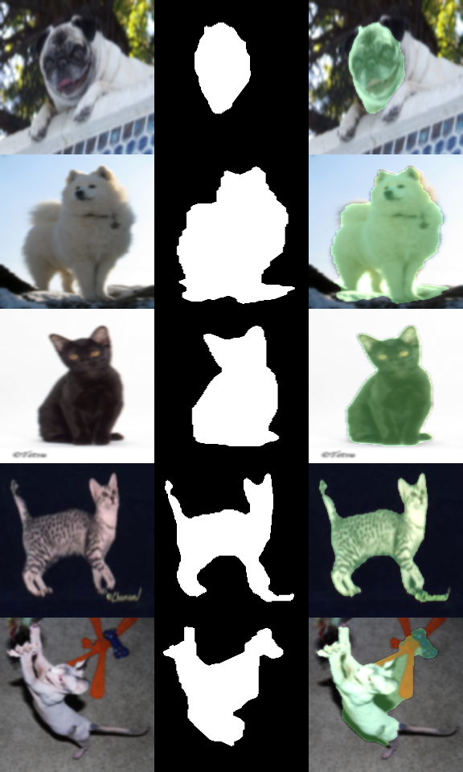
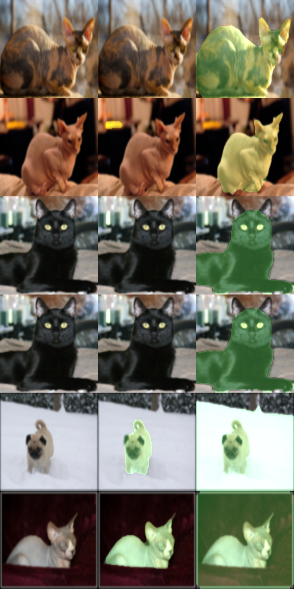

# 2. Tiền xử lý và phân đoạn

Code: [`features/features.py`](../features/features.py), các hàm `load_bgr`, `preprocess`, `segment_pet`.

## Đọc ảnh

```python
data = np.fromfile(path, dtype=np.uint8)
img = cv2.imdecode(data, cv2.IMREAD_COLOR)
```

Dùng `np.fromfile` + `cv2.imdecode` thay cho `cv2.imread` vì `cv2.imread` trên Windows không đọc được đường dẫn có ký tự Unicode (tên thư mục tiếng Việt chẳng hạn).

## Tiền xử lý

1. **Resize** sao cho cạnh dài bằng 192px, giữ nguyên tỷ lệ khung.
   - Ảnh gốc có kích thước rất khác nhau (từ khoảng 200px đến hơn 1000px). Đưa về cùng tỷ lệ giúp các đặc trưng phụ thuộc kích thước (như số pixel trong mask) so sánh được với nhau.
   - 192px là điểm cân bằng giữa tốc độ và chất lượng: GrabCut ở 256px mất khoảng 0.38 giây/ảnh, ở 192px khoảng 0.12 giây/ảnh.
2. **Gaussian blur 5×5** để giảm nhiễu và chi tiết lông quá nhỏ, giúp GrabCut ổn định hơn và histogram màu mượt hơn.

## Phân đoạn bằng GrabCut

Mục tiêu: tạo mask nhị phân, 255 ở pixel thuộc con vật, 0 ở pixel nền. Mọi đặc trưng sau đó chỉ tính trên vùng mask.

### Ý tưởng GrabCut

GrabCut mô hình hóa màu của tiền cảnh và hậu cảnh bằng hai mô hình hỗn hợp Gauss (GMM), rồi dùng **graph cut** để gán nhãn từng pixel sao cho:

- pixel có màu giống GMM tiền cảnh thì được gán tiền cảnh,
- pixel cạnh nhau có màu giống nhau thì nên cùng nhãn (ràng buộc làm trơn).

Thuật toán lặp: gán nhãn → học lại GMM → gán nhãn lại.

### Khởi tạo

GrabCut cần được cho biết trước vùng nào là nền, vùng nào là tiền cảnh. Hàm `grabcut_init_mask` tạo một mask khởi tạo bốn mức:

| Vùng | Nhãn | Ý nghĩa |
|---|---|---|
| 1% sát mép ảnh | `GC_BGD` | chắc chắn là nền |
| dải 1–5% tiếp theo | `GC_PR_BGD` | có thể là nền |
| elip ở tâm, rộng 20% mỗi chiều | `GC_FGD` | chắc chắn là con vật |
| phần còn lại | `GC_PR_FGD` | có thể là con vật |

```python
mask = grabcut_init_mask(h, w)
cv2.setRNGSeed(0)
cv2.grabCut(img, mask, None, bgd, fgd, 5, cv2.GC_INIT_WITH_MASK)
```

Chạy 5 vòng lặp. Pixel có nhãn cuối cùng là `GC_FGD` hoặc `GC_PR_FGD` được giữ lại. `cv2.setRNGSeed(0)` cố định phần ngẫu nhiên của GrabCut (khởi tạo GMM bằng k-means), để cùng một ảnh luôn cho cùng một mask.

Giả định ngầm: **con vật phủ lên tâm ảnh**. Không còn giả định con vật không chạm mép.

Nếu GrabCut lỗi (ví dụ ảnh quá nhỏ), mask mặc định là toàn bộ ảnh.

### Vì sao không dùng hình chữ nhật

Phiên bản đầu dùng cách khởi tạo phổ biến nhất: một hình chữ nhật cách mép 8%, mọi pixel ngoài nó là nền chắc chắn, chạy 1 vòng. Cách này có hai vấn đề với ảnh thú cưng:

1. **Con vật thường chạm mép ảnh.** Phần chạm mép nằm ngoài hình chữ nhật nên bị coi là nền chắc chắn và không bao giờ được lấy lại. Tệ hơn, màu của phần đó bị đưa vào GMM nền, khiến GrabCut gán cả phần thân còn lại là nền. Khi con vật chiếm gần hết khung hình, mask thường rỗng hoàn toàn.
2. **Không có điểm neo tiền cảnh.** Khi màu con vật gần màu nền, GrabCut có thể gán cả con vật là nền.

Cách mới sửa (1) bằng cách chỉ coi 1% sát mép là nền chắc chắn, và dải tiếp theo chỉ là "có thể" nên GrabCut vẫn có thể đổi chúng thành tiền cảnh. Elip ở tâm sửa (2).

### Hậu xử lý bằng hình thái học

Mask thô từ GrabCut thường có lỗ thủng và đốm nhiễu. Dùng phần tử cấu trúc hình elip 5×5:

1. **Đóng (close)** 2 lần: giãn rồi co, lấp các lỗ nhỏ bên trong con vật (ví dụ mắt, vùng lông tối).
2. **Mở (open)** 1 lần: co rồi giãn, xóa các đốm nhỏ lẻ ở nền.
3. **Giữ contour lớn nhất** và tô đặc nó. Bỏ mọi vùng rời rạc khác.

Bước 3 giả định ảnh chỉ có một con vật chính, đúng với hầu hết ảnh trong bộ Oxford-IIIT Pet.

## Đo chất lượng phân đoạn

Code: [`features/segmentation_eval.py`](../features/segmentation_eval.py), chạy bằng `python evaluate_segmentation.py` (cần `python download_data.py --trimaps` trước).

Bộ Oxford-IIIT Pet có **trimap** cho từng ảnh: mask do người gán nhãn, mỗi pixel là con vật (1), nền (2) hoặc viền (3). Trimap được dùng **chỉ để chấm điểm** mask GrabCut; đặc trưng và k-NN không bao giờ dùng trimap, nên bước phân đoạn vẫn hoàn toàn do project tự làm.

Thước đo, bỏ qua pixel viền:

- **IoU** = |mask ∩ trimap| / |mask ∪ trimap|. Bằng 1 khi khớp hoàn toàn; dưới 0.5 coi là phân đoạn sai nặng.
- **Precision** của mask: trong số pixel mask lấy, bao nhiêu thật sự là con vật. Thấp nghĩa là **dính nền**.
- **Recall** của mask: trong số pixel con vật, mask lấy được bao nhiêu. Thấp nghĩa là **thiếu con vật**.

10 trong 1.000 ảnh có trimap bị hỏng (gần như không có pixel con vật) và được bỏ qua.

### So sánh các cách khởi tạo

Các biến thể được thử trên 990 ảnh (một số chỉ trên mẫu 250 ảnh, 50 ảnh mỗi giống):

| Cách khởi tạo | IoU | IoU < 0.5 | Precision | Recall | Giây/ảnh |
|---|---:|---:|---:|---:|---:|
| Hình chữ nhật 8%, 1 vòng (cũ) | 0.655 | 27.4% | 0.822 | 0.753 | 0.10 |
| Hình chữ nhật 3%, 5 vòng | ≈ 0.70 | ≈ 23% | — | — | 0.45 |
| **Mask viền/tâm, 5 vòng (hiện tại)** | **0.716** | **22.1%** | **0.839** | **0.848** | 0.35 |
| Hiện tại + chạy lại khi mask phủ > 75% ảnh | 0.723 | 21.9% | 0.848 | 0.844 | 0.38 |
| Hiện tại + tự động cắt khung viền | 0.720 | 21.7% | 0.841 | 0.848 | 0.34 |
| Hiện tại, chạy trên ảnh Lab thay vì BGR | ≈ 0.72 | ≈ 20% | — | — | 0.50 |

- Lợi ích chính đến từ việc **thu hẹp vùng nền chắc chắn**: recall tăng từ 0.75 lên 0.85, tức mask lấy được nhiều phần thân hơn.
- Ba biến thể cuối không cải thiện thêm đáng kể (chênh dưới 0.01, trong khi chạy lại cùng cấu hình cũng dao động khoảng 0.01 do yếu tố ngẫu nhiên của GrabCut), nên project giữ cách đơn giản nhất.
- Elip tâm 20% tốt hơn 30% và 40% một chút; elip lớn hơn dễ ép nền vào tiền cảnh khi con vật lệch tâm.

Theo từng giống (cách hiện tại):

| Giống | IoU | IoU < 0.5 | Precision | Recall |
|---|---:|---:|---:|---:|
| Pug | 0.729 | 17.5% | 0.875 | 0.831 |
| Samoyed | 0.731 | 21.0% | 0.861 | 0.841 |
| Bombay | 0.723 | 22.5% | 0.847 | 0.843 |
| Egyptian Mau | 0.751 | 19.5% | 0.841 | 0.884 |
| Sphynx | 0.648 | 30.0% | 0.772 | 0.840 |

Sphynx khó nhất, chủ yếu do precision thấp: da hồng/xám dễ lẫn với chăn, gối, thảm nên mask lấy dính nền.

### Ảnh hưởng tới nhận dạng

| | Cách cũ | Cách hiện tại |
|---|---:|---:|
| Accuracy test, 10 seed | 59.3% ± 3.6 | **61.1% ± 2.8** |
| Accuracy cross-validation trên train, 10 seed | 59.1% | **62.9%** (tăng ở cả 10/10 seed) |
| Chỉ dùng đặc trưng màu | 55.6% | 58.6% |

Accuracy cross-validation tính trên 800 ảnh nên ổn định hơn accuracy trên 200 ảnh test, và nó tăng ở mọi seed, nên cải thiện là thật dù mức tăng trên test (1.8 điểm) nằm trong độ dao động.

## Kết quả và giới hạn



Mỗi hàng: ảnh sau tiền xử lý, mask, ảnh chồng mask (vùng xanh là tiền cảnh). Thứ tự từ trên xuống: Pug, Samoyed, Bombay, Egyptian Mau, Sphynx.

| Ảnh | Kết quả | Lý do |
|---|---|---|
| Pug | Chỉ lấy được phần mặt, mất cả thân | Thân màu kem gần với màu tường phía sau nên bị GMM gán là nền |
| Samoyed | Tốt | Lông trắng tương phản rõ với nền trời và đất |
| Bombay | Rất tốt | Mèo đen trên nền trắng |
| Egyptian Mau | Tốt, giữ được cả chân và đuôi | Nền tối đồng nhất |
| Sphynx | Lấy dính đồ chơi phía sau | Đồ chơi chạm vào con vật nên bị gộp vào vùng lớn nhất |

So sánh cách cũ (cột giữa) và cách hiện tại (cột phải):



Bốn hàng đầu là các ảnh cải thiện nhiều nhất (IoU từ 0 lên khoảng 0.97): con vật chiếm gần hết khung hình nên cách cũ cắt mất phần chạm mép và trả về mask rỗng. Hai hàng cuối là các ảnh tệ đi nhiều nhất: nền đồng nhất (tuyết, nền tối) khiến vùng nền chỉ học được một màu rất hẹp, và mask tràn ra gần hết ảnh. Trên 990 ảnh, 342 ảnh có IoU tăng hơn 0.05, 149 ảnh giảm hơn 0.05.

Quy luật chung: GrabCut làm tốt khi **màu con vật khác hẳn màu nền**, và thất bại khi chúng gần nhau. Đây là giới hạn của phương pháp chỉ dựa trên màu, không sửa được hoàn toàn bằng cách chỉnh khởi tạo.

Hệ quả cho các bước sau:

- mask thiếu phần thân thì đặc trưng màu chỉ phản ánh phần mặt,
- mask dính nền thì histogram màu bị pha màu nền,
- đặc trưng hình dạng bị ảnh hưởng nặng nhất vì nó đo trực tiếp đường viền của mask.

Xem [06-huong-cai-thien.md](06-huong-cai-thien.md) cho các hướng cải thiện tiếp.
