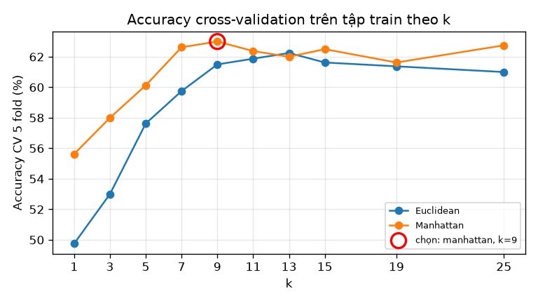
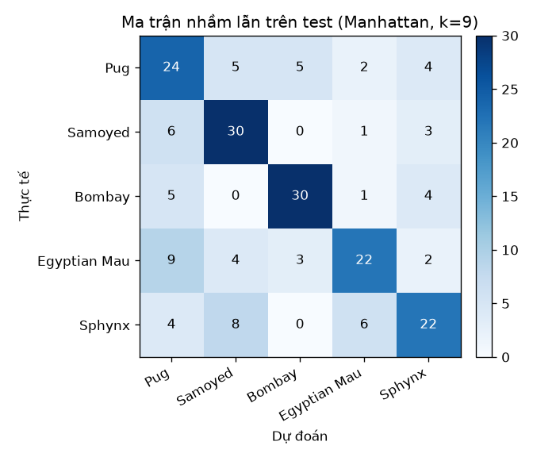

# 5. Đánh giá

Code: [`knn/evaluate.py`](../knn/evaluate.py); các hàm metric trong [`knn/knn.py`](../knn/knn.py); cross-validation trong [`knn/validation.py`](../knn/validation.py).

## Quy trình

1. Chia 1.000 ảnh thành 800 train / 200 test, phân tầng (mỗi giống 160 / 40).
2. Trên 800 ảnh train, chạy cross-validation 5 fold cho mọi cặp khoảng cách (Euclidean, Manhattan) × $k$ (1, 3, 5, 7, 9, 11, 13, 15, 19, 25). Chọn cặp có accuracy CV cao nhất.
3. Chuẩn hóa trên 800 ảnh train, chạy k-NN với cặp đã chọn, đánh giá **một lần** trên 200 ảnh test.
4. Lặp bước 1–3 với seed 0–9 (10 cách chia khác nhau), báo cáo trung bình ± độ lệch chuẩn.

Lý do của từng bước được giải thích ở [04-knn.md](04-knn.md), mục "Chọn k bằng cross-validation". Tóm tắt: tập test không tham gia vào bất kỳ quyết định nào, nên accuracy trên test là ước lượng không thiên lệch cho ảnh mới. Lặp nhiều seed cho biết con số đó dao động bao nhiêu.

Đặc trưng mặc định: màu + hình học, 27 chiều (xem [03-dac-trung.md](03-dac-trung.md)).

### Các thước đo

**Accuracy**

$$\text{accuracy} = \frac{\text{số ảnh dự đoán đúng}}{\text{tổng số ảnh test}}$$

5 lớp cân bằng (mỗi lớp 40 ảnh test) nên accuracy là thước đo hợp lý. Mốc so sánh: đoán ngẫu nhiên đạt 20%.

**Ma trận nhầm lẫn**

Ma trận $C$ kích thước 5×5, $C_{ij}$ là số ảnh **thực tế** thuộc lớp $i$ nhưng **dự đoán** là lớp $j$.

- Đường chéo: dự đoán đúng. Tổng mỗi hàng bằng 40.
- Ngoài đường chéo: cho biết **cặp lớp nào hay bị nhầm**, và theo chiều nào.

**Precision, recall, F1 theo lớp** (hàm `per_class_metrics`)

- Recall của lớp $i$ = $C_{ii} / \sum_j C_{ij}$: trong số ảnh thật của lớp $i$, đoán đúng bao nhiêu.
- Precision của lớp $j$ = $C_{jj} / \sum_i C_{ij}$: trong số ảnh bị đoán là lớp $j$, đúng bao nhiêu.
- F1 = $2 \cdot \text{precision} \cdot \text{recall} / (\text{precision} + \text{recall})$: trung bình điều hòa của hai giá trị trên.

Accuracy chung có thể che mất một lớp yếu; các thước đo theo lớp chỉ ra chính xác lớp nào yếu và yếu theo kiểu nào (bị bỏ sót hay bị nhận nhầm).

## Kết quả chính

| | Accuracy trên test |
|---|---:|
| Trung bình 10 seed | **61.1% ± 2.8%** |
| Thấp nhất / cao nhất | 57.0% / 65.0% |
| `seed=42` | 64.0% |

CV chọn **Manhattan ở cả 10 seed**. Giá trị $k$ được chọn: 19 (4 lần), 25 (3), 7, 13, 15 (mỗi giá trị 1 lần).

Khoảng dao động 57.0%–65.0% là lớn. Nguyên nhân chính là tập test nhỏ: với 200 ảnh, mỗi ảnh đúng/sai thay đổi accuracy 0.5 điểm, và việc ảnh "khó" (phân đoạn lỗi) rơi vào test nhiều hay ít phụ thuộc may rủi. Vì vậy **chênh lệch dưới khoảng 3–4 điểm giữa hai phương án không đủ để kết luận phương án nào tốt hơn**.

### Ảnh hưởng của k và khoảng cách



Accuracy cross-validation trên 800 ảnh train với `seed=42`:

| $k$ | 1 | 3 | 5 | 7 | 9 | 11 | 13 | 15 | 19 | 25 |
|---|---:|---:|---:|---:|---:|---:|---:|---:|---:|---:|
| Euclidean | 49.8 | 53.0 | 57.6 | 59.8 | 61.5 | 61.9 | 62.3 | 61.6 | 61.4 | 61.0 |
| Manhattan | 55.6 | 58.0 | 60.1 | 62.6 | **63.0** | 62.4 | 62.0 | 62.5 | 61.6 | 62.8 |

- **Manhattan tốt hơn Euclidean ở 9/10 giá trị $k$**, và chênh lệch lớn nhất ở $k$ nhỏ (5.9 điểm ở $k=1$). L2 bình phương độ lệch nên một chiều lệch lớn chi phối cả khoảng cách; L1 cộng tuyến tính nên các chiều đóng góp đều hơn. Với vector trộn màu và hình học, nơi một vài chiều có thể nhiễu do phân đoạn lỗi, L1 bền hơn.
- **$k$ nhỏ kém rõ rệt.** $k=1$ thấp hơn đỉnh 7–12 điểm: một láng giềng duy nhất quá nhạy với ảnh bị phân đoạn sai hoặc ảnh lạ.
- **Với Manhattan, đường gần như phẳng từ $k=7$ đến $k=25$** (dao động trong khoảng 1.5 điểm). Đó là lý do CV chọn $k$ khác nhau giữa các seed: các giá trị này gần như tương đương, và sai số ngẫu nhiên quyết định cái nào nhỉnh hơn.
- **Với Euclidean, đạt đỉnh ở $k=13$ rồi giảm nhẹ**: láng giềng xa bắt đầu đến từ lớp khác.

## Đọc ma trận nhầm lẫn



`seed=42`, Manhattan, $k=9$, accuracy 64.0%:

| Giống | Đúng / 40 | Precision | Recall | F1 | Hay bị nhầm thành |
|---|---:|---:|---:|---:|---|
| Bombay | 30 | 78.9% | 75.0% | **76.9%** | Pug (5), Sphynx (4) |
| Samoyed | 30 | 63.8% | 75.0% | 69.0% | Pug (6), Sphynx (3) |
| Egyptian Mau | 22 | 68.8% | 55.0% | 61.1% | Pug (9), Samoyed (4) |
| Pug | 24 | 50.0% | 60.0% | 54.5% | Samoyed (5), Bombay (5), Sphynx (4) |
| Sphynx | 22 | 62.9% | 55.0% | 58.7% | Samoyed (8), Egyptian Mau (6) |

Giải thích:

- **Bombay tốt nhất** nhờ lông đen tuyền cho $\mu_V$ thấp hẳn các giống khác. **Samoyed** cũng có recall 75% nhờ lông trắng.
- **Pug "hút" ảnh của các giống khác**: precision chỉ 50%, tức một nửa số ảnh bị đoán là Pug thực ra là giống khác (9 Mau, 6 Samoyed, 5 Bombay, 4 Sphynx). Mask Pug thường không đầy đủ (chỉ lấy mặt, hoặc dính nền), nên các vector Pug trải rộng trong không gian đặc trưng và trở thành láng giềng của nhiều ảnh lạ.
- **Sphynx ↔ Egyptian Mau** (6 ảnh Sphynx bị đoán là Mau): cả hai có tông xám/nhạt, dáng mảnh, tai to. Nét phân biệt chính của Mau là **đốm**, tức kết cấu, mà vector hiện tại không mô tả.
- **Sphynx → Samoyed** (8 ảnh): da hồng nhạt có S thấp, V cao, gần với lông trắng; Sphynx cũng là giống có mask dính nền nhiều nhất (precision mask 0.77, xem [02-tien-xu-ly-va-phan-doan.md](02-tien-xu-ly-va-phan-doan.md)), nên màu nền sáng (chăn, gối) lẫn vào đặc trưng.

## Đóng góp của từng nhóm đặc trưng (ablation)

Cùng quy trình (CV chọn tham số, 10 seed), chỉ thay đổi nhóm đặc trưng:

```bash
python evaluate.py --features color,geometry,hu
python evaluate.py --features color
...
```

| Đặc trưng | Số chiều | Accuracy test (10 seed) |
|---|---:|---:|
| Màu + hình học + Hu | 34 | 60.6% ± 2.5 |
| **Màu + hình học (mặc định)** | 27 | **61.1% ± 2.8** |
| Chỉ màu | 22 | 58.6% ± 3.3 |
| Hình học + Hu | 12 | 32.4% ± 2.4 |
| Chỉ hình học | 5 | 31.1% ± 3.5 |
| Chỉ Hu moments | 7 | 29.3% ± 0.8 |

Kết luận:

- **Màu mang phần lớn thông tin.** Chỉ màu đã đạt 58.6%.
- **5 đặc trưng hình học bổ sung khoảng 2.5 điểm** khi gộp với màu, dù một mình chỉ đạt 31%. Hai nhóm mang thông tin khác nhau: màu cho biết "lông màu gì", hình học cho biết "dáng tròn hay mảnh".
- **Hu moments không có ích.** Một mình gần mức đoán bừa (29.3% so với 20%), và thêm vào không tăng accuracy. Chúng bị bỏ khỏi bộ mặc định vì làm vector dài hơn mà không mang thêm thông tin. Mức chênh 60.6% so với 61.1% nằm trong độ dao động, nên **không** được coi là bằng chứng bỏ Hu làm tăng accuracy.

## Các phiên bản

| Phiên bản | Thay đổi | Accuracy báo cáo |
|---|---|---:|
| 1 | Chọn $k \le 11$ trực tiếp trên tập test, một seed | 58.0% (lạc quan) |
| 2 | Chọn $k \le 25$ bằng cross-validation trên train, 10 seed, bỏ Hu | 59.3% ± 3.6 |
| 3 | Khởi tạo GrabCut bằng mask viền/tâm, 5 vòng | **61.1% ± 2.8** |

Con số của phiên bản 1 không so sánh trực tiếp được với hai phiên bản sau, vì nó dùng tập test để chọn $k$.

Phiên bản 1 còn dẫn tới một kết luận sai: "hình dạng gần như không giúp". Ở $k=5$ cố định, màu + hình dạng và chỉ màu cho cùng 55.5%. Khi cho phép CV chọn $k$ lớn hơn, lợi ích của hình học mới lộ ra, có lẽ vì vote trên nhiều láng giềng làm mượt nhiễu của từng chiều hình dạng. Bài học: một cấu hình cố định có thể che mất đóng góp của một nhóm đặc trưng; so sánh đặc trưng nên được làm **sau khi** chọn siêu tham số riêng cho từng phương án.

Ảnh hưởng của phân đoạn (phiên bản 3) được phân tích ở [02-tien-xu-ly-va-phan-doan.md](02-tien-xu-ly-va-phan-doan.md).

## Tái tạo các con số

```bash
python evaluate.py                                # kết quả chính và bảng CV
python evaluate.py --features color,geometry,hu   # một dòng trong bảng ablation
python evaluate.py --repeats 0                     # chỉ chạy seed=42, bỏ phần lặp
```

Lần đầu mất khoảng 1 phút để trích đặc trưng (chạy song song); các lần sau dùng cache, mỗi lần chạy khoảng 30 giây.
